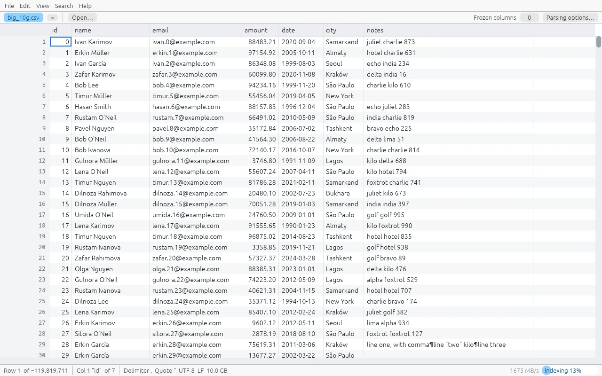
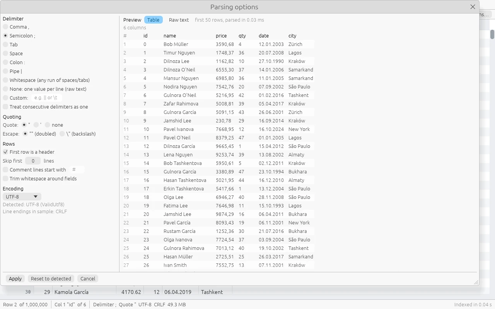
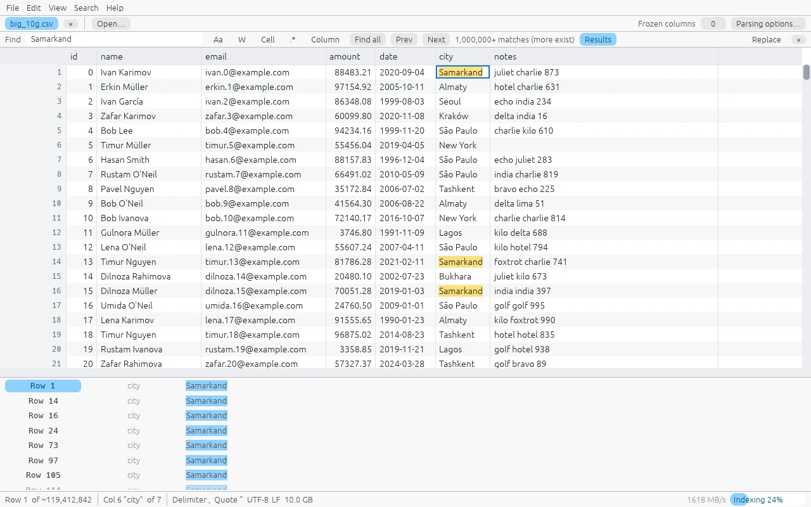
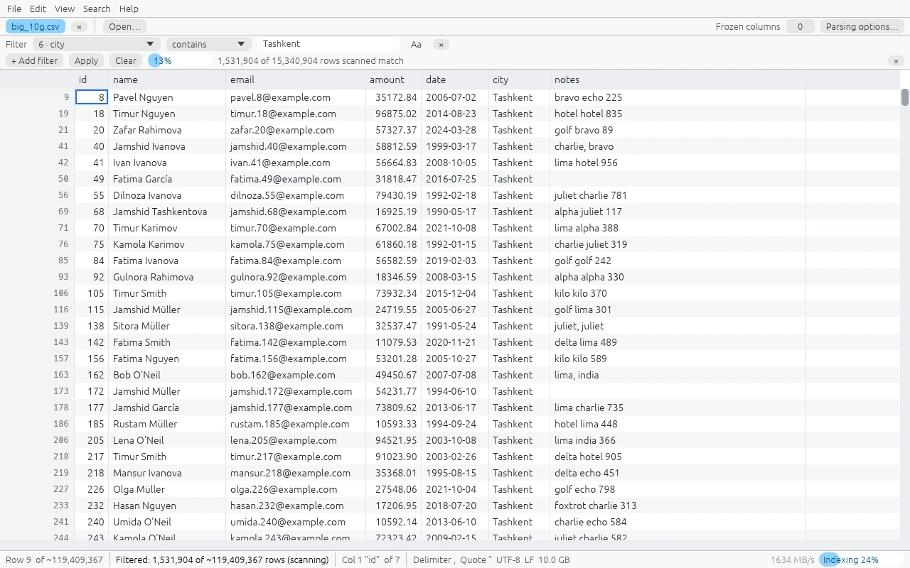
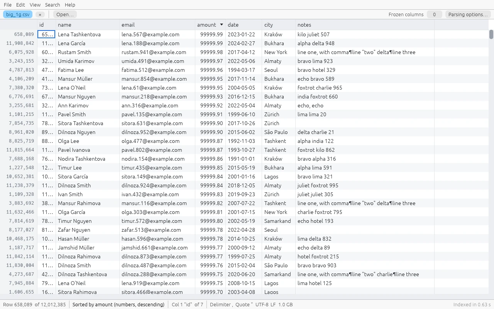
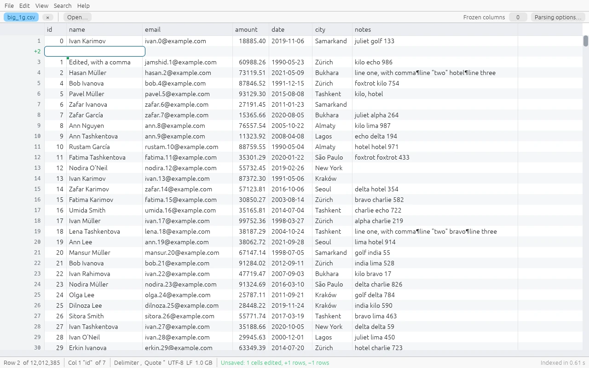
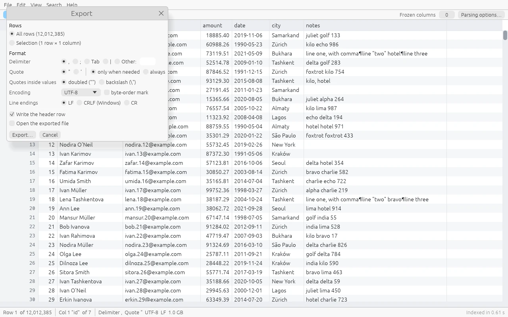

<p align="center">
  
</p>

<h1 align="center">Katak — fast viewer and editor for huge CSV files</h1>

<p align="center">
  <b>Open 1 GB, 10 GB or 50 GB CSV and TSV files instantly. Search, filter, sort, edit and convert them without loading the file into memory.</b><br>
  Free and open source · Windows, macOS and Linux · one small native binary, written in Rust
</p>

<p align="center">
  <a href="https://github.com/Erkinbek/katak/releases/latest"></a>
  <a href="https://github.com/Erkinbek/katak/actions/workflows/ci.yml"></a>
  <a href="LICENSE"></a>
  
</p>

<p align="center">
  <a href="#download"><b>Download</b></a> ·
  <a href="https://erkinbek.github.io/katak/">Website</a> ·
  <a href="#features">Features</a> ·
  <a href="#performance">Benchmarks</a> ·
  <a href="#faq">FAQ</a>
</p>

<picture>
  <source media="(prefers-color-scheme: dark)" srcset="docs/images/hero-dark.webp">
  
</picture>

<p align="center"><sub>A 10 GB CSV file with 119 million rows: on screen 0.2 s after launch, while the rest of the file is indexed in the background at 1.6 GB/s.</sub></p>

## Why Katak

Excel and LibreOffice Calc stop at 1,048,576 rows. Text editors try to read
the whole file and freeze. Importing into a database takes minutes before
you see a single row. Katak (Uzbek for "cell") is made for the CSV files
that are too big for everything else:

* **Opens any size instantly.** Only the first megabyte is read to show the
  first screen, about 0.2 s after launch even for a 50 GB file. Row counts
  are estimated until the background index catches up.
* **Never freezes.** Indexing, search, filter, sort, replace and save run in
  the background with progress and cancel. The UI thread never waits for
  the disk; measured frame times stay below 10 ms.
* **Never loads the file into RAM.** The file is memory-mapped and only the
  visible cells are parsed. A 50 GB file, open and fully indexed, uses
  127 MB of memory.
* **Edits without damage.** Changes are kept as an overlay and saved by
  streaming into a temp file that atomically replaces the original. Rows you
  did not touch are copied byte for byte: no re-quoting, no reformatted
  numbers or dates, no lost leading zeros.
* **One portable binary.** About 12 MB, no installer needed, no Java, .NET
  or Python. Katak never connects to the internet.

## Download

| Platform | Download |
|----------|----------|
| Windows 10 / 11 (x64) | [Installer](https://github.com/Erkinbek/katak/releases/latest/download/katak-windows-x64-setup.exe) · [Portable .exe](https://github.com/Erkinbek/katak/releases/latest/download/katak-windows-x64.exe) · [MSI](https://github.com/Erkinbek/katak/releases/latest/download/katak-windows-x64.msi) for IT deployment |
| macOS, Apple Silicon | [katak-macos-arm64.tar.gz](https://github.com/Erkinbek/katak/releases/latest/download/katak-macos-arm64.tar.gz) |
| macOS, Intel | [katak-macos-x64.tar.gz](https://github.com/Erkinbek/katak/releases/latest/download/katak-macos-x64.tar.gz) |
| Linux x64 (glibc 2.35+) | [katak-linux-x64.tar.gz](https://github.com/Erkinbek/katak/releases/latest/download/katak-linux-x64.tar.gz) |

Every release, with SHA-256 checksums, is on the
[releases page](https://github.com/Erkinbek/katak/releases). With a Rust
toolchain you can also run
`cargo install --git https://github.com/Erkinbek/katak --locked katak`, or
[build from source](#building-from-source).

> The binaries are not code-signed yet. On Windows, SmartScreen may ask you
> to confirm (More info → Run anyway). On macOS, run
> `xattr -d com.apple.quarantine katak` once after extracting, or
> right-click the file and choose Open.

Then open a file with File → Open, by dropping it on the window, with
"Open with" in Explorer (the installer registers `.csv`, `.tsv` and
`.txt`) or from a terminal:

```sh
katak data.csv other.tsv
```

## Features

### Opens any CSV, TSV or delimited text file

Katak detects the delimiter, quote character, escape style, header row,
encoding and line endings from the first megabyte, and handles Excel's
`sep=;` line. Everything can be changed in the parsing dialog, with a live
preview of the first 50 rows: comma, semicolon, tab, space, colon, pipe or
any custom multi-character delimiter, "treat consecutive delimiters as
one", whitespace-aligned files, quote `"` / `'` / none, doubled or
backslash escapes, skipped lines, comment lines and trimming (off by
default). A raw-text view shows the bytes as they are, and "one value per
line" opens any text file as a list of lines.

<picture>
  <source media="(prefers-color-scheme: dark)" srcset="docs/images/parse-dark.webp">
  
</picture>

### Search and filter at gigabytes per second

* **Search** (Ctrl+F): plain text or regex, match case with Unicode case
  folding, whole word, whole cell, current column only. Results stream in
  while the search runs (0.8–1.4 GB/s on cached files), F3 jumps to the next
  match before it finishes, and up to 1,000,000 results are listed.
* **Filter** (Ctrl+Shift+L): contains / equals / starts with / regex / empty /
  not empty / numeric range per column, combined with AND. Matching rows
  appear in the grid with their original row numbers while the filter is
  still running.
* Search and filter see your unsaved edits, and work on UTF-16 and legacy
  code-page files too.

<picture>
  <source media="(prefers-color-scheme: dark)" srcset="docs/images/search-dark.webp">
  
</picture>

<picture>
  <source media="(prefers-color-scheme: dark)" srcset="docs/images/filter-dark.webp">
  
</picture>

### Sorts millions of rows

Right-click a column header to sort as numbers, dates or text, ascending or
descending. The sort runs in the background and is shown as a view; the
file is only reordered if you export or "Save sorted as…". 12 million rows
sort in 1.2 s within a 512 MB memory budget (configurable).

<picture>
  <source media="(prefers-color-scheme: dark)" srcset="docs/images/sort-dark.webp">
  
</picture>

### Edit like a spreadsheet, save without surprises

Double-click, F2 or just start typing. Copy, cut and paste as TSV
(Excel-compatible), fill down, insert and delete rows, insert, rename, move
and delete columns, undo and redo everything. **Find & Replace** (Ctrl+H)
supports regex capture groups (`$1`, `${name}`); up to 50,000 changed cells
are one undoable step, larger replacements rewrite the file in a single
streaming pass. Saving (Ctrl+S) keeps the original delimiter, quoting,
encoding and line endings; a save without edits is byte-identical, and an
optional `.bak` keeps the previous version.

<picture>
  <source media="(prefers-color-scheme: dark)" srcset="docs/images/edit-dark.webp">
  
</picture>

### Converts and exports

Export (Ctrl+E) all rows, the filtered or sorted rows, or a selection (with
only its columns) to a new file with another delimiter, quoting policy,
encoding (with or without BOM) or line ending. Exports stream with bounded
memory: a 10 GB file converts at 350–400 MB/s using 53 MB of RAM.

<picture>
  <source media="(prefers-color-scheme: dark)" srcset="docs/images/export-dark.webp">
  
</picture>

### Built for awkward files

* Quoted fields with delimiters, quotes and line breaks (LF, CR, CRLF) are
  parsed correctly, also when jumping into the middle of a file.
* Ragged rows are highlighted and counted (F8 jumps to the next one);
  unterminated quotes are reported with their byte offset.
* Files with 10,000 or 1,000,000 columns scroll smoothly: only the visible
  rows *and* columns are parsed and drawn. A single 500 MB cell opens as a
  bounded preview.
* Encodings: UTF-8, UTF-16 LE/BE, Windows code pages, ISO-8859-x, KOI8,
  Shift_JIS, EUC, GBK/GB18030, Big5 and more, auto-detected or chosen with
  File → Reopen with encoding. Invalid bytes show as `�`, never a crash.
* Network and USB drives are read in the background, so a slow or
  disconnected share never freezes the window. If another program changes
  or deletes the open file, Katak offers to reload it.
* Go to any row (Ctrl+G) or byte offset (Ctrl+Shift+G), even before
  indexing finishes. Tabs, light and dark themes, zoom, frozen columns,
  column types for alignment and sorting (displayed text is never changed),
  and a status bar with the sum, average, min and max of the selection.

## Performance

Measured on an Intel Core Ultra 9 285 (24 cores), Windows 11, files in the
OS cache, release build. Files come from `tools/katak-gen`.

| Target | Goal | Measured |
|--------|------|----------|
| Startup to first frame with data (10 GB / 50 GB file) | < 300 ms | **198 ms / 231 ms** |
| Open + first screen in the core (any size) | < 300 ms | **2–7 ms** (cached) |
| Parsing-dialog preview update | < 100 ms | **0.03 ms** |
| Background indexing, 1 GB file | ≥ 500 MB/s | **1.66–1.75 GB/s** |
| Background indexing, 10 GB / 50 GB file | ≥ 500 MB/s | **1.56 GB/s (6.6 s) / 1.44 GB/s (35 s)** |
| Indexing, whitespace-aligned (generic path) | ≥ 500 MB/s | **681–764 MB/s** |
| Indexing, UTF-16LE | ≥ 500 MB/s | **810 MB/s** |
| Indexing, 100 million 1-character rows | ≥ 500 MB/s | **655–660 MB/s** |
| Jump to any indexed row + render 60×40 cells | < 50 ms | **avg 0.1–0.7 ms, worst 3.1 ms** |
| UI time per frame, scrolling while indexing runs | < 16 ms | **max 0.37 ms** |
| UI time per frame, scrollbar jumps into the un-indexed part | < 16 ms | **max 5.1 ms** |
| 10,000-column file, horizontal scroll | 60 fps | **max 1.9 ms/frame** |
| 1,000,000-column file, horizontal scroll | 60 fps | **max 0.14 ms/frame** |
| Index memory | < 1 % of file | **0.024–0.048 %** (50 GB file: 16 MB) |
| Private memory, 50 GB file open and indexed | < 300 MB | **24 MB core, 127 MB whole app** |
| Literal search, 1 GB / 10 GB file | ≥ 500 MB/s | **1.27–1.37 GB/s / 0.95–1.0 GB/s** |
| Case-insensitive literal search, 1 GB | ≥ 500 MB/s | **809 MB/s** |
| Regex search, 1 GB / 10 GB | ≥ 200 MB/s | **1.14–1.31 GB/s / 975 MB/s** |
| Filter (literal / numeric range), 1 GB | ≥ 500 MB/s | **1.31–1.34 GB/s / 792 MB/s** |
| Filter (literal / numeric range), 10 GB | ≥ 500 MB/s | **1.17–1.23 GB/s / 771 MB/s** |
| UI frame time with highlighting / filtered view | < 16 ms | **max 4.6 ms / 9.0 ms** |
| Save, zero edits (10 GB) | byte-identical | **identical, 1.54 GB/s** |
| Save with a handful of edits (10 GB): private memory | < 300 MB | **29 MB peak** |
| Save with a handful of edits (10 GB): throughput | disk-bound | **554 MB/s** (the disk was flushing the previous 10 GB write; 1.3 GB/s for 1 GB) |
| Sort 12 M rows (1 GB): numbers / few-valued text / all-distinct text | default 512 MB budget | **1.19 s / 1.59 s / 3.8 s**, 414 MB peak |
| Sort 119 M rows (10 GB), 8 GB budget: numbers / text | bounded memory | **14.1 s / 15.1 s**, 3.6 GB peak (refused at 512 MB with the size needed) |
| UI time per frame in a sorted 12 M-row view | < 16 ms | **max 3.7 ms** |
| UI time per frame, 10 GB file read like a network drive with 150 ms per 1 MB block | never blocks | **max 1.8 ms** (frame interval max 17 ms) |
| UI time per frame, 50 GB file while indexing (scroll, scrollbar jumps, go to row) | < 16 ms | **max 4.7 ms** |
| Export to TSV + CRLF, 1 GB / 10 GB | streaming | **355–362 MB/s / 356–400 MB/s**, 53 MB peak |
| Export in sort order, 1 GB / 10 GB | no random reads | **7.0 s / 72 s** |
| Replace all as a streaming rewrite (~10 % of rows), 10 GB | streaming | **349–399 MB/s**, 62 MB peak |

Reproduce with:

```sh
cargo run --release -p katak-gen                       # writes testdata/generated/ (~12 GB)
cargo run --release -p katak-bench -- testdata/generated/big_10g.csv --suite --save --convert
target/release/katak testdata/generated/big_10g.csv --perf perf.log --self-test
KATAK_TEST_READ_DELAY_MS=150 target/release/katak testdata/generated/big_10g.csv --buffered --perf perf.log --self-test
```

`--self-test` opens the file, scrolls vertically, jumps with the scrollbar,
scrolls horizontally and jumps to random rows for a few seconds, appends
frame-time statistics to the log and exits.

## Keyboard shortcuts

| Keys | Action |
|------|--------|
| Ctrl+O | Open files |
| Ctrl+W | Close tab |
| Ctrl+Tab | Next tab |
| Ctrl+Shift+P | Parsing options |
| Ctrl+F | Find |
| Ctrl+H | Replace |
| F3 / Shift+F3 | Next / previous match |
| Ctrl+Shift+L | Filter bar |
| Ctrl+S / Ctrl+Shift+S | Save / Save as |
| Ctrl+E | Export / convert |
| Ctrl+Z / Ctrl+Y | Undo / redo |
| F2, double-click, typing | Edit the cell |
| Enter / Tab / Esc (editing) | Commit and move down / right, cancel |
| Ctrl+C / Ctrl+X / Ctrl+V | Copy / cut / paste (TSV) |
| Delete / Ctrl+D / Ctrl+A | Clear / fill down / select all |
| Ctrl+G | Go to row |
| Ctrl+Shift+G | Go to byte offset |
| F8 | Next ragged row |
| Arrow keys | Move the cursor (Shift extends the selection) |
| Page Up / Page Down | Page up / down |
| Home / End | First / last column |
| Ctrl+Home / Ctrl+End | First / last row |
| Shift+mouse wheel | Scroll horizontally |
| Ctrl+Plus / Ctrl+Minus / Ctrl+0 | Zoom in / out / reset |
| Right-click a cell | Rows, columns, clipboard, filter |
| Right-click a column header | Sort, filter this column, auto-fit, freeze, column type |
| F1 | Shortcut list |

## FAQ

### How do I open a CSV file that is too large for Excel?

Open it in Katak (File → Open, drag and drop, or `katak file.csv`). There is
no row limit: the first rows appear immediately and the rest of the file is
indexed in the background. To get the data into Excel afterwards, filter it
down or select the part you need and export it as a smaller CSV.

### How large a file can Katak open?

Files are memory-mapped, so the limit is your disk, not your RAM. Katak is
tested with 50 GB files, 119 million rows, 100 million one-character rows
and 1,000,000 columns. The index takes about 0.03 % of the file size.

### Does Katak load the whole file into memory?

No. Only the visible rows and columns are read and parsed. Search, filter,
sort and save stream through the file on background threads with bounded
memory.

### Will saving change data I did not edit?

No. Untouched rows are copied byte for byte, and Katak never reformats
numbers or dates, strips leading zeros or trims whitespace. Saving writes a
temp file next to the original, flushes it and atomically replaces the
original, so a crash or a full disk never leaves a half-written file.

### Can it open TSV, semicolon, pipe or space-aligned files?

Yes: any single or multi-character delimiter, runs of spaces or tabs, and
plain text with one value per line. Fixed-width columns are not supported
yet.

### Can I convert a huge CSV, change its delimiter or encoding, or extract part of it?

Yes, with Export (Ctrl+E): all rows, the filtered rows, the sorted order or
a selection, with another delimiter, quoting, encoding or line ending. It
streams, so a 10 GB conversion needs about 50 MB of RAM.

### Is Katak free?

Yes. Katak is open source under the MIT license, with no account, no
telemetry and no network access.

### What does Katak not do yet?

Search does not look into newly inserted rows, inserted rows are not part
of filtered or sorted views, right-to-left scripts are shown without
shaping, and there is no fixed-width mode. See the
[issues](https://github.com/Erkinbek/katak/issues) and feel free to open
one.

## Building from source

Install Rust (stable) from <https://rustup.rs>. The repository pins the
stable channel in `rust-toolchain.toml`.

```sh
git clone https://github.com/Erkinbek/katak.git
cd katak
cargo build --release -p katak
```

The binary is `target/release/katak` (`katak.exe` on Windows).

* **Windows**: use the MSVC toolchain (`x86_64-pc-windows-msvc`, the
  default) with the "Desktop development with C++" build tools. The
  resulting `katak.exe` is portable. The optional installer is built with
  [Inno Setup](https://jrsoftware.org/isinfo.php):
  `ISCC.exe /DAppVersion=0.5.1 packaging\windows\katak.iss`.
* **Linux**: install the X11/Wayland headers egui needs, e.g. on Debian or
  Ubuntu `sudo apt install libxcb-render0-dev libxcb-shape0-dev
  libxcb-xfixes0-dev libxkbcommon-dev libgl1-mesa-dev`. File dialogs use
  the XDG desktop portal, so GTK is not needed.
* **macOS**: Xcode command line tools. Build both architectures with
  `--target aarch64-apple-darwin` and `--target x86_64-apple-darwin`.

CI (GitHub Actions) builds and tests on Windows, Linux and macOS on every
push and pull request; pushing a `v*` tag builds release binaries for all
platforms plus the Windows installer and attaches them to a GitHub Release.

## How it works

The file is memory-mapped (or read in bounded chunks on network drives) and
never copied. A background thread builds a sparse, quote-aware index: one
checkpoint per ~64 KB at a true row start, so a row inside a multi-line
quoted field is never mistaken for a row start. The grid jumps to the
nearest checkpoint and parses only the visible rows and columns. Edits live
in an overlay over the unchanged file, with undo and redo; saving streams
the file through the overlay into a temp file and renames it over the
original. The details are in [docs/ARCHITECTURE.md](docs/ARCHITECTURE.md),
and the original requirements in [docs/SPEC.md](docs/SPEC.md).

| Path | Contents |
|------|----------|
| `crates/katak-core` | file access, quote-aware scanner, sparse index, locator, detection, document model (no GUI) |
| `crates/katak` | the egui application |
| `tools/katak-gen` | test-data generator |
| `tools/katak-bench` | throughput and memory benchmarks on real files |
| `docs/ARCHITECTURE.md` | design |

## Contributing

Bug reports, ideas and pull requests are welcome; see
[CONTRIBUTING.md](CONTRIBUTING.md). Before every commit:

```sh
cargo fmt --all
cargo clippy --workspace --all-targets -- -D warnings
cargo test --workspace
```

Changes are listed in the [CHANGELOG](CHANGELOG.md). If Katak saved you
from a frozen spreadsheet, a ⭐ on GitHub helps others find it.

## License

[MIT](LICENSE) © 2026 Erkin Pardayev
